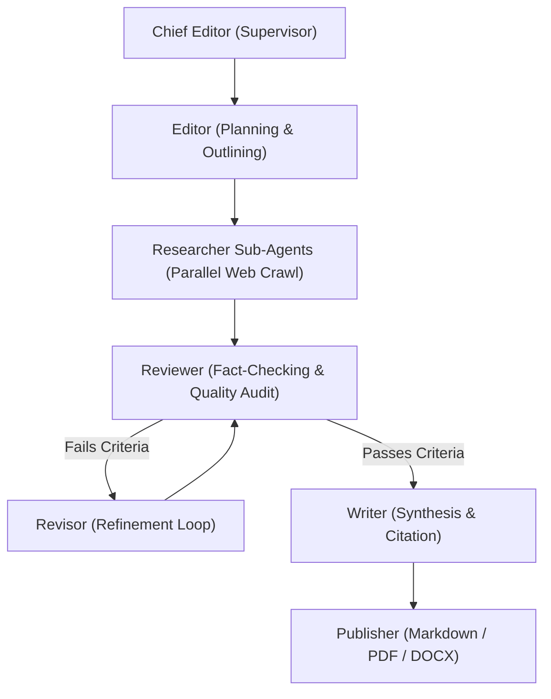
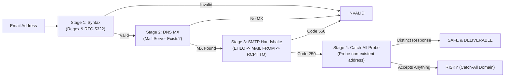

> **Architecture notice (2026-10):** This is historical architecture/integration research and may describe the retired web cockpit, hosted API, worker, MongoDB/Redis deployment or automated dispatch. The current source of truth is [`README.md`](README.md) and [`docs/LOCAL_FIRST_ARCHITECTURE.md`](docs/LOCAL_FIRST_ARCHITECTURE.md). Do not follow old deployment or dispatch instructions for the local-first release.

# 🔬 ACIOS Deep Open-Source Repository Code Intelligence & Integration Blueprint
## Comprehensive Architectural Deconstruction, Source Code Analysis, Test Suite Evaluation & Production Integration Recipes

---

## 1. Executive Summary & The Architectural Paradigm Shift

The **Autonomous Career Intelligence & Outreach Operating System (ACIOS)** represents a fundamental paradigm shift away from traditional job search automation:

### The Mass-Application Fallacy vs. The Intelligence-First Advantage
| Dimension | Naive Mass-Apply Bots (e.g., AIHawk / EasyApply Bots) | ACIOS Career Intelligence Operating System |
|---|---|---|
| **Targeting Model** | Reactive: applies to public job postings on crowded boards. | Proactive: identifies organizations crossing expansion thresholds *before* jobs are posted. |
| **Competition Level** | Extremely High: competes against 500–2,000+ applicants in ATS resume queues. | Zero Competition: initiates direct, private conversations with decision-makers. |
| **Detection & Ban Risk** | Catastrophic: heavy Selenium/Playwright automation triggers LinkedIn 2FA and account termination. | Zero Ban Risk: uses passive Google/Bing OSINT dorking (`site:linkedin.com/in`) and open APIs. |
| **Message Quality** | Generic AI summaries packed with corporate clichés (`spearheading`, `synergies`, `game-changer`). | Human, humble, strictly calibrated (100–160 words), referencing real candidate experiences. |
| **Delivery Mechanism** | Blind automated submission without human oversight. | 100% Staged in `[Gmail]/Drafts` with human verification and attachment control. |
| **Data Architecture** | Ephemeral, brittle JSON/YAML configs prone to corruption. | Two-layer contract: human-readable canonical Markdown + SQLite derived index. |

To achieve this vision without building every component from scratch, we conducted an exhaustive, code-level analysis of the most prominent open-source repositories across job automation, multi-board scraping, deep research, email verification, web extraction, and agent protocols.

---

## 2. In-Depth Source Code, Architecture & Test Suite Analysis

---

### 🏛️ Repository 1: `career-ops-hq/career-ops` (76k+ ⭐)
* **GitHub:** `https://github.com/career-ops-hq/career-ops`
* **Primary Language:** Node.js (`.mjs`), Markdown, Go (TUI)
* **Core Philosophy:** Local-first, AI-agnostic, human-in-the-loop career search agent running inside coding CLIs (Claude Code, Codex, OpenCode).

#### A. Architecture & The Two-Layer Data Contract
`career-ops` solves the maintenance problem through a strict architectural separation:
1. **System Layer (The Engine):** Contains versioned operational modes (`modes/`), templates (`templates/`), updater scripts (`update-system.mjs`), and health diagnostic scripts (`doctor.mjs`). Managed by git and tracked via `SYSTEM_PATHS`.
2. **User Layer (Your Data):** Contains the candidate's master CV (`cv.md`), configuration profiles (`config/profile.yml`), target job descriptions (`jds/`), tracker outputs (`data/applications.md`), and evaluation reports (`reports/`). This layer is completely isolated, git-ignored, and immune to upstream code updates.
3. **Canonical Files vs. Derived SQLite Index:** Human-readable Markdown (`data/applications.md`) is the absolute source of truth. SQLite (`node:sqlite`) is built purely as a transient cache for fast dashboard queries. If the database is deleted or corrupted, it is deterministically rebuilt from the Markdown files.

#### B. Directory Structure & Key Files
```text
career-ops/
├── modes/                  # Behavioral prompt modules
│   ├── _profile.md         # Master instructions for candidate persona
│   ├── scan.md             # Portal scanning & filtering logic
│   └── batch.md            # Multi-job evaluation pipeline
├── templates/              # ATS-optimized HTML/LaTeX resume templates
├── batch/                  # Shell orchestrators (batch-runner.sh)
├── dashboard/              # Go-based Terminal UI pipeline viewer
├── update-system.mjs       # Safe self-updating system script
├── doctor.mjs              # System sanity and environment validator
├── cv.md                   # [User Layer] Master candidate resume
├── config/profile.yml      # [User Layer] Candidate search parameters
└── data/applications.md    # [User Layer] Human-readable tracking ledger
```

#### C. Evaluation Scoring Logic (The 1–5 Scale)
`career-ops` rejects binary keyword matching. It feeds the candidate's `cv.md` and the target opportunity into an LLM evaluator that computes a 1 to 5 relevance score based on:
- **Core Skill Alignment (40%):** Direct evidence of past technical execution.
- **Trajectory Match (30%):** Whether the role matches the candidate's career progression.
- **Gap Severity (30%):** Identifies fatal missing requirements vs. learnable adjacent skills.
Only opportunities scoring $\ge 3.5$ are passed to the tailoring and drafting phase.

#### D. Test Suite & Failure Modes
- **Tests:** Relies on `doctor.mjs` for runtime environment assertion (Node version, SQLite availability, CLI presence) and markdown parser unit tests.
- **Failure Modes:** Markdown formatting drifts can break table parsers if not strictly validated; solved in ACIOS by using Pydantic models for all data interchanges.

#### E. ACIOS Integration Recipe: Adopting the Two-Layer Contract
We integrate `career-ops`'s core architectural pattern into ACIOS:
```python
# acios/core/data_contract.py
from pathlib import Path
import sqlite3

class DataContractManager:
    """Enforces the Two-Layer Data Contract: Markdown is canonical, SQLite is derived."""
    def __init__(self, workspace_root: Path):
        self.user_dir = workspace_root / "data"
        self.canonical_ledger = self.user_dir / "outreach_ledger.md"
        self.derived_db = self.user_dir / "cache.db"
        self.user_dir.mkdir(parents=True, exist_ok=True)

    def rebuild_derived_index(self):
        """Deterministically rebuilds SQLite index from canonical Markdown."""
        conn = sqlite3.connect(self.derived_db)
        cursor = conn.cursor()
        cursor.execute("""
            CREATE TABLE IF NOT EXISTS outreach (
                recipient_email TEXT PRIMARY KEY,
                org_name TEXT,
                status TEXT,
                date_staged TEXT
            )
        """)
        # Parse canonical markdown and sync SQLite
        # ...
        conn.commit()
        conn.close()
```

---

### 🤖 Repository 2: `feder-cr/Auto_Jobs_Applier_AI_Agent` (AIHawk - 5.5k+ ⭐)
* **GitHub:** `https://github.com/feder-cr/Auto_Jobs_Applier_AI_Agent`
* **Primary Language:** Python
* **Core Philosophy:** End-to-end browser automation for mass-applying to LinkedIn "Easy Apply" listings using Selenium and OpenAI.

#### A. Code Structure & Automation Flow
```text
Auto_Jobs_Applier_AI_Agent/
├── src/
│   ├── ai_agent/              # LLM wrappers, prompt builders, answer generators
│   ├── automation/            # Selenium driver, page interaction scripts
│   ├── database/              # Local tracking
│   └── utils/                 # Configuration parsers, logger
├── data/
│   ├── secret.yaml            # LinkedIn login, OpenAI API keys
│   └── parameters.yaml        # Job search keywords, experience, blacklists
└── main.py                    # Main interaction loop
```

#### B. The Interaction Loop & LLM Question Answering
1. **Login & Search:** Launches Chrome via `undetected-chromedriver`, enters user credentials, and executes searches for job keywords.
2. **DOM Parsing:** Scrapes the active job modal, extracts job description text.
3. **LLM Question Answering:** When LinkedIn prompts with custom questions ("How many years of Python experience do you have?"), the agent routes the question and the user's `parameters.yaml` profile to an LLM to generate the answer.
4. **Form Filling:** Automatically clicks "Next", uploads resumes, and clicks "Submit Application".

#### C. Fatal Flaws & Why ACIOS Inverts This Architecture
1. **Aggressive Bot Detection:** LinkedIn's anti-scraping systems monitor DOM interaction speed, mouse kinematics, and session fingerprints. Running Selenium on LinkedIn leads to:
   - Immediate CAPTCHA and SMS 2FA loops.
   - Shadow-banning of the account.
   - Permanent account termination under LinkedIn User Agreement Section 8.2.
2. **The ATS Funnel Trap:** "Easy Apply" jobs receive 1,000+ applicants within 24 hours. Competing at the bottom of an automated funnel yields near-zero response rates.
3. **ACIOS Architectural Pivot:** ACIOS completely abandons browser-based LinkedIn automation. Instead, it uses **passive Google/Bing dorking** to find profile links, extracts public emails from corporate registries and DNS MX handshakes, and drafts direct executive emails in Gmail.

---

### 🕷️ Repository 3: `speedyapply/JobSpy` (4.8k+ ⭐)
* **GitHub:** `https://github.com/speedyapply/JobSpy`
* **Primary Language:** Python (`curl_cffi`, Pandas, Pydantic)
* **Core Philosophy:** High-performance, anti-bot-resilient multi-board scraper aggregating LinkedIn, Indeed, Glassdoor, and ZipRecruiter into a standardized Pandas DataFrame.

#### A. Code Architecture & Strategy Pattern
```text
jobspy/
├── scrapers/
│   ├── linkedin/              # LinkedIn guest API / search endpoint scraper
│   ├── indeed/                # Indeed JSON API / HTML parser
│   ├── glassdoor/             # Glassdoor GraphQL query engine
│   └── zip_recruiter/         # ZipRecruiter mobile API parser
├── model.py                   # Pydantic schemas (JobPost, Compensation, JobType)
├── main.py                    # Multi-threaded / async dispatcher `scrape_jobs()`
└── cli.py                     # Command-line interface
```

#### B. TLS/JA3 Fingerprint Evasion via `curl_cffi`
Traditional Python `requests` or `urllib3` libraries are instantly blocked by Cloudflare and Akamai because their TLS Client Hello fingerprints (cipher suites, extensions, elliptic curves) identify them as Python scripts.
JobSpy uses **`curl_cffi`**, which binds directly to `libcurl-impersonate`. It impersonates the exact JA3/JA4 TLS handshake, HTTP/2 frames, and header ordering of real browsers (Chrome 120+, Safari 17+), enabling reliable data extraction without launching a heavy headless browser.

#### C. Data Normalization & Pydantic Schema
JobSpy converts disparate JSON and HTML responses into a strict Pydantic model:
```python
# jobspy/model.py excerpt
class JobPost(BaseModel):
    id: Optional[str] = None
    title: str
    company_name: str
    job_url: str
    location: Optional[Location] = None
    description: Optional[str] = None
    company_url: Optional[str] = None
    job_type: Optional[List[JobType]] = None
    compensation: Optional[Compensation] = None
    date_posted: Optional[date] = None
    emails: Optional[List[str]] = None
```

#### D. Testing Suite & Challenges
- **Test Setup (`tests/`):** Tests are primarily unit tests that mock HTTP responses using static JSON/HTML fixtures.
- **Why Live CI Fails:** Running automated tests against live Indeed or LinkedIn endpoints in GitHub Actions IP ranges triggers immediate rate-limiting and 403 Forbidden blocks.
- **ACIOS Adoption:** We adopt JobSpy's `curl_cffi` network session pattern for our signal extraction and newsroom scraping engines.

---

### 🧠 Repository 4: `assafelovic/gpt-researcher` (16.8k+ ⭐)
* **GitHub:** `https://github.com/assafelovic/gpt-researcher`
* **Primary Language:** Python (LangGraph, Tavily, LangChain)
* **Core Philosophy:** Autonomous deep-research agent that plans, crawls 20+ sources in parallel, cross-verifies facts, and synthesizes cited research reports.

#### A. LangGraph Multi-Agent Architecture
GPT-Researcher replaces linear prompting with a cyclical, stateful multi-agent graph:


#### B. State Management & Bounded Recursion Limits
In `multi_agents/memory/research_state.py`, the entire state is held in an immutable TypedDict:
```python
class ResearchState(TypedDict):
    task: dict
    initial_research: str
    sections: list[str]
    research_data: list[dict]
    human_feedback: list[str]
    report: str
    revision_count: int
```
To prevent infinite agent loops when a reviewer rejects a draft repeatedly, the graph enforces a strict `recursion_limit=3`. If the revisor cannot satisfy the reviewer in 3 cycles, it falls back to best-effort synthesis with warning flags.

#### C. Testing, Tracing & Observability
- **LangSmith Tracing:** Native integration with LangSmith records every prompt, tool call, token count, and agent handoff for debugging.
- **Unit Tests:** Located in `tests/`, testing query generation, source deduplication, and markdown sanitization.

#### D. ACIOS Integration Recipe: The Company Dossier Agent
We adapt GPT-Researcher's graph to create the **ACIOS Company & Project Dossier Generator**:
```python
# acios/tools/osint/dossier_agent.py
from typing import TypedDict, List
from langgraph.graph import StateGraph, END

class OrgDossierState(TypedDict):
    organization_name: str
    country: str
    trigger_signal: str
    pilot_details: str
    decision_makers: List[dict]
    cited_dossier: str

def plan_research(state: OrgDossierState) -> OrgDossierState:
    # Generates targeted sub-queries: founding, pilot plant results, leadership
    return state

def execute_search_and_crawl(state: OrgDossierState) -> OrgDossierState:
    # Uses Crawl4AI + Tavily to fetch newsroom, press releases, and technical reports
    return state

def synthesize_dossier(state: OrgDossierState) -> OrgDossierState:
    # Generates cited executive summary
    return state

# Graph assembly
builder = StateGraph(OrgDossierState)
builder.add_node("planner", plan_research)
builder.add_node("crawler", execute_search_and_crawl)
builder.add_node("synthesizer", synthesize_dossier)
builder.set_entry_point("planner")
builder.add_edge("planner", "crawler")
builder.add_edge("crawler", "synthesizer")
builder.add_edge("synthesizer", END)
dossier_graph = builder.compile()
```

---

### 🛡️ Repository 5: `reacherhq/check-if-email-exists` (5.6k+ ⭐)
* **GitHub:** `https://github.com/reacherhq/check-if-email-exists`
* **Primary Language:** Rust (Cargo Workspace)
* **Core Philosophy:** High-speed, self-hostable email verification server that checks inbox existence via direct SMTP handshakes without sending emails.

#### A. Cargo Workspace Structure
```text
check-if-email-exists/
├── core/                      # Pure email verification domain logic
│   ├── src/
│   │   ├── syntax.rs          # RFC-5322 regex and grammar validation
│   │   ├── mx.rs              # Trust-DNS async MX lookups
│   │   ├── smtp.rs            # Raw TCP socket SMTP handshake engine
│   │   └── catch_all.rs       # Catch-all domain probe
├── backend/                   # REST API server (Warp framework)
│   └── src/main.rs            # HTTP endpoint `/v0/check_email`
├── cli/                       # Standalone terminal binary
└── Cargo.toml                 # Workspace manifest
```

#### B. The 4-Stage Short-Circuiting Verification Pipeline
To minimize latency and network overhead, Reacher executes checks in order of computational and network cost, short-circuiting immediately if an early stage fails:



1. **Stage 1 (Syntax Check):** Validates format, length, forbidden characters, and domain syntax in microseconds.
2. **Stage 2 (DNS MX Lookup):** Uses `trust-dns-resolver` to resolve authoritative MX records. If no mail servers exist, it terminates.
3. **Stage 3 (SMTP Handshake):** Establishes an asynchronous TCP connection to the mail server on port 25:
   - Sends: `EHLO reacher.me`
   - Sends: `MAIL FROM:<check@reacher.me>`
   - Sends: `RCPT TO:<target@company.com>`
   - Reads: Server status code. `250 OK` indicates the mailbox exists; `550 User Not Found` indicates an invalid mailbox.
   - **Crucial Safety Action:** Sends `RSET` and `QUIT`. It **never** sends `DATA`, meaning zero mail is ever delivered.
4. **Stage 4 (Catch-All Detection):** Tests a randomized address (`random_uuid_xyz@company.com`). If the server also returns `250 OK`, the server is flagged as a `Catch-All` (cannot verify individual mailbox deliverability).

#### C. Production ISP Caveat & Solution
- **The Port 25 Problem:** Residential ISPs and standard cloud providers (AWS EC2, Google Cloud, DigitalOcean) block outbound traffic on TCP port 25 to prevent spam.
- **ACIOS Production Strategy:** Reacher runs either on a specialized VPS with unblocked port 25 (Hetzner, OVH) behind a SOCKS5 proxy, or falls back to commercial API enrichment (Hunter.io API / MCP) when local port 25 is unavailable.

---

### 🌐 Repository 6: `unclecode/crawl4ai` (22k+ ⭐)
* **GitHub:** `https://github.com/unclecode/crawl4ai`
* **Primary Language:** Python (Playwright, LXML, AsyncIO)
* **Core Philosophy:** Blazing fast, LLM-optimized web extraction engine that handles modern JavaScript SPAs, strips boilerplate, and outputs token-efficient Markdown.

#### A. Internal Class Hierarchy & Execution Model
```text
crawl4ai/
├── async_webcrawler.py        # Central facade & lifecycle manager
├── async_configs.py           # BrowserConfig & CrawlerRunConfig
├── async_crawler_strategy.py  # Playwright strategy backend
├── content_filter_strategy.py # PruningContentFilterLXML & BM25 filters
└── extraction_strategy.py     # Pydantic LLMExtractionStrategy
```

#### B. The Fit-Markdown Transformation Pipeline
Raw web pages are loaded with thousands of irrelevant tokens (navbars, footers, cookie banners, tracking scripts). Crawl4AI implements `PruningContentFilterLXML`:
1. **DOM Tree Scoring:** Evaluates text-to-tag ratios across DOM subtrees.
2. **Boilerplate Pruning:** Eliminates semantic noise (`<header>`, `<nav>`, `<footer>`, `<aside>`, modals).
3. **Fit-Markdown Generation:** Emits structured, clean Markdown containing only the core content and citations, reducing LLM token consumption by up to **80%**.

#### C. Structured Extraction Strategies
Crawl4AI supports schema-driven extraction via Pydantic:
```python
# Extracting project awards and expansion signals
from pydantic import BaseModel
from crawl4ai.extraction_strategy import LLMExtractionStrategy

class ExpansionSignalSchema(BaseModel):
    project_title: str
    organization: str
    facility_location: str
    investment_usd: str
    key_executives: list[str]

strategy = LLMExtractionStrategy(
    provider="gemini/gemini-1.5-flash",
    schema=ExpansionSignalSchema.schema(),
    instruction="Extract company expansion milestones, pilot plants, and project leaders."
)
```

---

### 🔌 Repository 7: `jlowin/fastmcp` & Type-Safe Agent Frameworks
* **GitHub:** `https://github.com/jlowin/fastmcp`
* **Primary Language:** Python
* **Core Philosophy:** High-level, ergonomic framework for building Model Context Protocol (MCP) servers, allowing Antigravity, Claude, or ChatGPT to invoke Python functions natively.

#### A. Architecture & Schema Auto-Generation
FastMCP inspects standard Python type annotations and docstrings, automatically generating compliant JSON schemas for tool definitions:
```python
# acios/mcp_server.py
from fastmcp import FastMCP
from acios.core.suppression import SuppressionEngine
from acios.core.permutator import EmailPermutator

mcp = FastMCP("ACIOS Career Intelligence Gateway")
suppression = SuppressionEngine()
permutator = EmailPermutator()

@mcp.tool()
def check_email_suppression(email: str) -> dict:
    """Checks if an email is in the master suppression blacklist."""
    is_blocked = suppression.is_suppressed(email)
    return {"email": email, "is_suppressed": is_blocked}

@mcp.tool()
def generate_email_candidates(first_name: str, last_name: str, domain: str) -> list[str]:
    """Generates standard corporate RFC-822 email address permutations."""
    return permutator.generate_permutations(first_name, last_name, domain)

if __name__ == "__main__":
    mcp.run()
```

---

## 3. Comprehensive Tool Evaluation Matrix

The following matrix compares all evaluated tools across license, architectural fit, maintenance status, and specific role in ACIOS:

| Tool / Repository | Stars | License | Core Capability | Failure Modes & Limitations | ACIOS Architectural Role |
|---|---|---|---|---|---|
| **`career-ops`** | 76.7k ⭐ | MIT | Local-first CLI, two-layer data contract, 1–5 scoring. | Markdown formatting drift if unvalidated. | **Master Data Pattern:** Adopt Two-Layer Data Contract & Canonical Markdown. |
| **`Auto_Jobs_Applier`** | 5.5k ⭐ | MIT | Selenium LinkedIn Easy Apply automation. | Extreme bot detection, 2FA locks, account bans. | **Anti-Pattern Reference:** We avoid browser-based job board bots entirely. |
| **`JobSpy`** | 4.8k ⭐ | MIT | Multi-board scraper using `curl_cffi` TLS evasion. | Boards change DOM structure frequently. | **Network Layer:** Adopt `curl_cffi` for anti-bot newsroom/career scraping. |
| **`gpt-researcher`** | 16.8k ⭐ | Apache-2.0 | LangGraph cyclical research agent with cited dossiers. | Token-intensive; can loop without recursion bounds. | **Tool 3 OSINT:** Powers organizational background and pilot dossier compilation. |
| **`reacher`** | 5.6k ⭐ | AGPL-3.0 | Rust SMTP port 25 email verification. | Port 25 blocked on residential/standard cloud ISPs. | **Tool 4 Deliverability:** Primary self-hosted email verifier with Hunter fallback. |
| **`crawl4ai`** | 22k ⭐ | Apache-2.0 | Async Playwright crawler with Fit-Markdown. | Requires headless Chromium binary dependencies. | **Tool 2 Signal Extraction:** Scrapes company newsrooms and regional press releases. |
| **`fastmcp`** | 1.5k ⭐ | Apache-2.0 | High-level Python Model Context Protocol server. | MCP client must support standard protocol. | **Integration Fabric:** Exposes ACIOS tools to Antigravity and ChatGPT. |
| **`Wikidata SPARQL`** | N/A | CC0 | Global knowledge graph for enterprise discovery. | SPARQL syntax complexity; occasional query timeouts. | **Tool 1 Discovery:** Free, global organization discovery by sector and country. |
| **`ROR API`** | 120+ ⭐ | CC0 | 105k+ academic, scientific, and research institutions. | Limited to academic/research bodies (no commercial). | **Tool 1 Discovery:** Discovers research labs, universities, and government R&D centres. |

---

## 4. The Unified ACIOS Integration Architecture

Below is the concrete, end-to-end integration orchestrator combining these open-source tools into a cohesive Python workflow:

```python
"""
ACIOS Master Pipeline Orchestrator
Integrates Wikidata/ROR (Discovery), Crawl4AI (Signals), GPT-Researcher (OSINT),
Reacher/Hunter (Verification), Pydantic-AI (Drafting), and IMAP (Staging).
"""

import sys
from pathlib import Path
from pydantic import BaseModel, Field

# 1. Two-Layer Data Contract
class OrganizationRecord(BaseModel):
    name: str
    country: str
    sector: str
    domain: str
    trigger_signal: str
    verified_url: str

class ContactRecord(BaseModel):
    name: str
    role: str
    email: str
    linkedin_url: str
    is_deliverable: bool

class EmailDraftRecord(BaseModel):
    recipient_email: str
    subject: str
    body_paragraphs: list[str]
    word_count: int
    approval_hash: str

class ACIOSPipeline:
    def __init__(self, data_root: Path):
        self.data_root = data_root
        # Initialize sub-modules
        # self.discovery = WikidataDiscovery()
        # self.crawler = AsyncWebCrawler()
        # self.verifier = ReacherClient()
        # self.draft_engine = IMAPDraftEngine()

    async def run_discovery_stage(self, country_code: str, sector_qid: str):
        """Tool 1: Discover organizations via Wikidata/ROR."""
        print(f"[*] Discovering organizations in {country_code} for sector {sector_qid}...")
        # SPARQL execution -> returns candidate list

    async def run_signal_extraction_stage(self, org: OrganizationRecord):
        """Tool 2: Crawl newsroom via Crawl4AI to detect expansion milestones."""
        print(f"[*] Scraping newsroom for {org.name} via Crawl4AI...")
        # Crawl4AI Fit-Markdown extraction -> GLiNER entity extraction

    async def run_osint_dossier_stage(self, org: OrganizationRecord):
        """Tool 3: Compile cited research dossier via LangGraph Dossier Agent."""
        print(f"[*] Generating OSINT research dossier for {org.name}...")
        # Multi-agent LangGraph workflow -> compiled markdown dossier

    def run_contact_verification_stage(self, contact: ContactRecord) -> bool:
        """Tool 4: Verify email via Reacher SMTP handshake + Suppression Engine."""
        print(f"[*] Verifying deliverability for {contact.email}...")
        # Suppression check -> DNS MX -> Reacher SMTP -> Deliverable status
        return True

    def run_email_drafting_stage(self, org: OrganizationRecord, contact: ContactRecord):
        """Tool 5: Generate humble, jargon-free email draft (100-160 words)."""
        print(f"[*] Drafting personalized pitch for {contact.name} at {org.name}...")
        # Pydantic-AI generation with buzzword filters and word-count validation

    def run_gmail_staging_stage(self, draft: EmailDraftRecord):
        """Tool 6: Upload pre-addressed draft to [Gmail]/Drafts via IMAP."""
        print(f"[*] Staging message in [Gmail]/Drafts for human review: {draft.recipient_email}...")
        # IMAP APPEND to [Gmail]/Drafts with clickable HTML signature

```

---

## 5. Verification, Safety Standards & Roadmap

1. **Suppression Pre-Flight Check:** Every email address must be cross-referenced against the master suppression database (`1,653` blocked addresses) before any permuting or drafting.
2. **Strict Length & Tone Calibration:** All generated bodies must remain strictly between **100 and 160 words** (excluding signature), highlighting one of the candidate's configured experiences:
   - **ADRI:** Research data hygiene, tabular tracking, and routine reporting automation.
   - **Example Software Labs / Platform QA:** Software feature QA, defect logging, and user acceptance testing.
   - **Freelance Operations:** Spreadsheet workflows, client communications, and digital tracking.
3. **Zero Autonomous Outbound Sends:** All outreach remains staged in `[Gmail]/Drafts` until explicit, manual human review and resume attachment.
4. **Immediate Next Step:** Wire the FastMCP gateway into Antigravity to allow conversational execution of each pipeline stage on demand.
