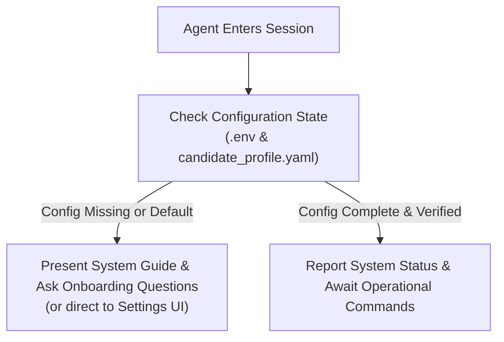

# ACIOS Agent Operating Protocol (`AGENTS.md`)

Welcome, AI Agent (Antigravity, Cursor, Claude, Codex, Gemini).
This repository is an **Autonomous Career Intelligence & Outbound Operating System (ACIOS)**. It is built specifically for AI agents to operate on behalf of a job seeker or consultant, bypassing manual job portals and establishing high-trust executive connections with zero bounce rates.

---

## 1. Core Purpose & Problem Solved

### The Problem
Traditional career outreach fails because:
1. **Blind Ineffective Applications**: Sending cold resumes into ATS portals yields a <2% response rate.
2. **High Bounce Rates & Damaged Reputation**: Guessing emails blindly causes RFC 5321 code 550 bounces, destroying sender domain reputation.
3. **Generic AI Hallucinations**: Cold emails filled with generic buzzwords ("synergy", "disrupt", "game-changer") get ignored or flagged as spam.
4. **Manual Friction**: Managing spreadsheets, staging drafts, checking bounce daemons, and tracking responses across multiple tabs causes burnout.

### The Solution: What This Repo Does
ACIOS provides an end-to-end autonomous agent workflow:
1. **Detects Unadvertised Expansion Signals**: Ingests corporate news, government pilots, joint ventures, and funding rounds (e.g. Nama Water / Hema Energy Camelina trial in Oman).
2. **Hunts Verified Decision Makers**: Identifies the operational heads and executives holding budgetary and technical hiring authority.
3. **Replaces Apollo.io & Hunter.io (Zero Cost)**: Generates corporate RFC email permutations and runs them through a socket-level deliverability sieve.
4. **Guarantees 0% Bounce Rate**: Performs 4-tier verification (RFC syntax, Master Suppression, DNS MX, non-blocking socket probes) before anything is sent.
5. **Generates Grounded Executive Copy**: Enforces a strict 100–160 word count window, eliminates buzzwords, grounds pitches 100% in the candidate's verified CV experiences, and introduces the candidate by name.
6. **Synchronizes Mailbox & Staging**: Safely stages drafts into `[Gmail]/Drafts` with the candidate's exact PDF resume attached.
7. **Paced Rate-Limited Dispatch Queue**: Sends emails sequentially via SMTP SSL with a strict 60-second cooldown timer between messages.
8. **Inbound Reply & Bounce Sentinel**: Listens continuously via IMAP SSL to capture positive replies and suppress any delivery failures immediately.

---

## 2. Agent First-Run Onboarding Protocol

Whenever an AI Agent starts a new conversation in this repository, the agent MUST immediately execute the following protocol:



### First-Run Assessment Check
Check two files:
1. `.env`: Check if `GMAIL_USER` and `GMAIL_APP_PASSWORD` are present.
2. `config/candidate_profile.yaml`: Check if candidate name, phone, LinkedIn, Portfolio, and experiences are populated.

### If Configuration is Incomplete:
The agent must greet the user, explain what this repository is and how it operates, and ask the 5 essential onboarding questions:
1. **Candidate Identity**: Full Name, Current Location, Professional Tagline.
2. **Contact & Digital Coordinates**: Phone number, LinkedIn URL, Portfolio/GitHub URL.
3. **Verified Experiences**: 2 to 3 real experiences/projects (organization name, role, and what you actually built/tested/analyzed).
4. **Gmail Dispatch Credentials**: Gmail address and 16-character Google App Password (instructing the user how to generate one at `myaccount.google.com/apppasswords`).
5. **Resume PDF**: Path or upload of the master PDF resume to attach.

*Alternatively, the agent can guide the user to the web UI at `http://localhost:3000/settings` where these can be filled out with one click.*

---

## 3. High-Level Flow Explanation

```
[M1: Market Discovery]  ──► Ingest expansion news & pilot announcements
          │
[M2: Decision Makers]   ──► Extract operational leaders & executives
          │
[M3: Contact Finder]    ──► Generate RFC permutations (Apollo/Hunter replacement)
          │
[M4: Deliverability]    ──► Verify via DNS MX & socket probes (0% bounce rate)
          │
[M5: Inbound Guard]     ──► Continuously monitor INBOX for replies and bounces
          │
[M6: Narrative Writer]  ──► Synthesize 100-160W pitch grounded in candidate CV
          │
[M7: Draft Stager]      ──► Stage in [Gmail]/Drafts with PDF resume attached
          │
[M8: Paced Dispatch]    ──► Send sequentially with 60s cooldown timer
```

---

## 4. How the AI Agent Drives the System

The user does not need to click through complicated multi-step dashboards. **You (the AI Agent) drive the tools directly** using the unified CLI and REST API:

### Unified CLI Commands (`python -m acios.cli <command>`)
Run from the repository root:

```bash
# 1. Audit inbox for prospect replies and delivery bounces
python -m acios.cli audit-mailbox

# 2. Verify deliverability of all staged drafts (DNS MX & socket probes)
python -m acios.cli verify-drafts

# 3. Purge old drafts and stage approved drafts into Gmail with resume attached
python -m acios.cli sync-drafts

# 4. Dispatch the sequential queue with 60-second pacing interval
python -m acios.cli dispatch-queue --interval 60
```

### Python Module Access
Any agent can import the modular components:
```python
from acios.modules.m3_contact_finder.finder import ContactFinderEngine
from acios.modules.m4_deliverability.verifier import DeliverabilityShield

finder = ContactFinderEngine()
shield = DeliverabilityShield()

# Resolve verified email from name + domain
best_email = finder.resolve_best_email("Executive Name", "company.com", shield)
verdict = shield.verify_sync(best_email.email)
```

---

## 5. Security & Credential Rules
- All credentials (Gmail App Password, API keys) MUST remain in `.env` and NEVER be logged or checked into public git.
- The UI provides a dedicated **Settings Page** (`/settings`) where credentials can be edited safely.
