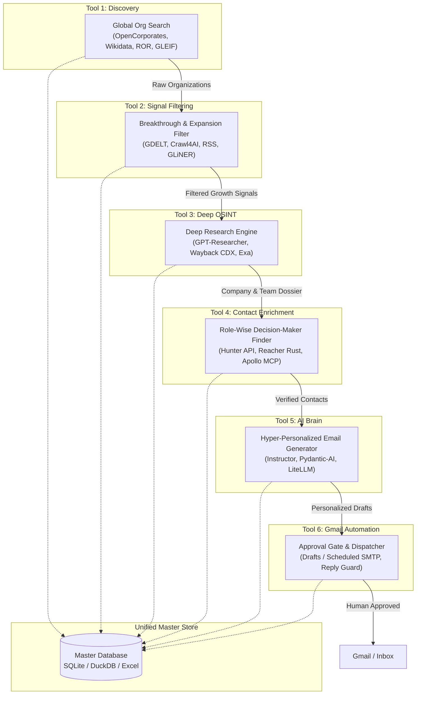

> **Architecture notice (2026-10):** This is historical architecture/integration research and may describe the retired web cockpit, hosted API, worker, MongoDB/Redis deployment or automated dispatch. The current source of truth is [`README.md`](README.md) and [`docs/LOCAL_FIRST_ARCHITECTURE.md`](docs/LOCAL_FIRST_ARCHITECTURE.md). Do not follow old deployment or dispatch instructions for the local-first release.

# 🚀 Autonomous Career Intelligence & Outreach Operating System (ACIOS)
## End-to-End Modular Architecture, Open-Source Tool Ecosystem & Implementation Blueprint

---

## 1. Executive Summary & Core Philosophy

> **The Reusability Principle:** *"Do not reinvent the wheel. Standardize the chassis, reuse battle-tested open-source engines, and orchestrate them through clean interfaces."*

The **Autonomous Career Intelligence & Outreach Operating System (ACIOS)** transforms job discovery from reactive job-board browsing into an **intelligence-driven, opportunity-discovery pipeline**. Instead of competing against thousands of applicants on public job postings, this system identifies organizations **before** a formal vacancy is created—detecting expansion thresholds (new funding, facility construction, pilot projects, commercialization agreements) and connecting with the exact project owners through authentic, human-toned outreach.



---

## 2. Detailed Technical Breakdown: The 6 Core Tools

---

### 🌐 Tool 1: Global Organization Discovery & Grounding Database
**Goal:** Query and retrieve organizations worldwide across all industries (AgriTech, BioTech, DeepTech, Clean Energy, Heavy Industry, Research Institutes, and IT) without scraping from scratch.

#### Top Industry-Grade Open-Source / Open-Data Engines:
1. **Wikidata SPARQL Query Service (`qwikidata` / `SPARQLWrapper`)**
   - **What it is:** Global knowledge graph maintained by Wikimedia. Over 100M items queryable via SPARQL.
   - **How it works:** Query companies by country (`P17`), industry sector (`P452`), date of inception (`P571`), and headquarters coordinates (`P625`).
   - **License:** CC0 (Public Domain). Unlimited free queries.
   - **Integration:** Python script queries SPARQL endpoint directly; returns structured JSON with company names, official websites, and founding dates.
2. **OpenCorporates API (`openc/opencorporates-python`)**
   - **What it is:** The largest open database of companies in the world (220M+ companies across 140+ jurisdictions).
   - **How it works:** Search legal entity names, active registration status, and corporate branch locations.
   - **License / Cost:** Free tier for non-commercial & research use; official REST API.
3. **Research Organization Registry (ROR) API (`ror-community/ror-api`)**
   - **What it is:** Global registry of 105,000+ research organizations, academic universities, and scientific institutions (including KAUST, SQU, Qatar University, MEWA).
   - **License:** CC0 (Free, no rate limits, no API key required).
4. **GLEIF (Global Legal Entity Identifier Foundation) API**
   - **What it is:** Official global database of legal entities (LEIs), ideal for identifying manufacturing, heavy industrial, and venture facilities.

```python
# Tool 1 Implementation: Wikidata Sector & Country Discovery
from SPARQLWrapper import SPARQLWrapper, JSON

def discover_organizations(country_code="SA", sector_qid="Q11451"): # Q11451 = Agriculture
    sparql = SPARQLWrapper("https://query.wikidata.org/sparql")
    query = f"""
    SELECT ?item ?itemLabel ?website WHERE {{
      ?item wdt:P31/wdt:P279* wd:Q4830453; # Instance of business enterprise
            wdt:P17 ?country;
            wdt:P452 wd:{sector_qid}.
      ?country wdt:P297 "{country_code}".
      OPTIONAL {{ ?item wdt:P856 ?website. }}
      SERVICE wikibase:label {{ bd:serviceParam wikibase:language "en". }}
    }} LIMIT 100
    """
    sparql.setQuery(query)
    sparql.setReturnFormat(JSON)
    return sparql.query().convert()["results"]["bindings"]
```

---

### 📡 Tool 2: Expansion & Breakthrough Signal Filtering
**Goal:** Ingest global news, press releases, and announcements, filtering exclusively for organizations crossing operational thresholds: **seed funding, new pilot plants, facility expansion, strategic joint ventures, or hiring drives**.

#### Top Open-Source Engines:
1. **Crawl4AI (`unclecode/crawl4ai`, 20k+ stars)**
   - **What it is:** Open-source, asynchronous web crawler designed specifically for LLMs. Handles JavaScript rendering, headless Chromium, anti-bot mitigation, and extracts clean Markdown/JSON.
   - **Role:** Deep scraping of company `/newsroom`, `/press`, or regional news outlets (Zawya, Wamda, Arab News).
2. **GDELT 2.0 Global Knowledge Graph (`gdeltdoc`)**
   - **What it is:** Global database monitoring broadcast, print, and web news globally in 100+ languages every 15 minutes.
   - **Role:** Real-time alert feed tracking expansion keywords (`"pilot plant"`, `"seed round"`, `"facility expansion"`, `"commercialization"`) filtered by country.
3. **GLiNER (`urchade/gliner`, 5k+ stars)**
   - **What it is:** Generalist and lightweight Named Entity Recognition model using bidirectional transformers.
   - **Role:** Extracts zero-shot entities from raw articles: `[Investment Amount]`, `[Facility Location]`, `[Partnership Type]`, `[Key People]`.

```python
# Tool 2 Implementation: Signal Extraction via GLiNER
from gliner import GLiNER

model = GLiNER.from_pretrained("urchade/gliner_base")

def extract_growth_signals(article_text: str):
    labels = ["funding_round", "facility_expansion", "project_launch", "decision_maker", "technology_name"]
    entities = model.predict_entities(article_text, labels, threshold=0.45)
    return {e["label"]: e["text"] for e in entities}
```

---

### 🔍 Tool 3: Deep Organization & People OSINT Engine
**Goal:** Gather comprehensive public context on the organization—founding history, core technologies, lab origins, patents, and team structure—while strictly respecting platform integrity and LinkedIn terms.

#### Top Open-Source Engines:
1. **GPT-Researcher (`assafelovic/gpt-researcher`, 16k+ stars)**
   - **What it is:** Autonomous agent that aggregates 20+ sources, cross-checks facts, and writes structured investigative dossiers with citations.
2. **Wayback Machine CDX API (`internetarchive/wayback-cdx-server`)**
   - **Role:** Audits the historical evolution of the company’s website to verify when pilots launched, how early products performed, and historical leadership changes.
3. **TheHarvester (`laramies/theHarvester`, 12k+ stars)**
   - **Role:** Discovers corporate domains, public staff profiles, and official endpoints from open search engines and public certificates.
4. **Compliant Professional Discovery Gateway:**
   - **Policy:** Strictly avoids brittle, unauthorized browser automation/scrapers that violate LinkedIn ToS and trigger account bans.
   - **Engine:** Generates deterministic Google/Bing search queries (`site:linkedin.com/in "Company Name" "Title"`) and public snippet parsing to locate direct profile URLs safely.

---

### 🎯 Tool 4: Role-Wise Decision-Maker Contact Discovery & Deliverability
**Goal:** Identify the exact humans closest to the work (R&D Lead, Product Manager, Operations Director, CTO) and verify their working email using a multi-engine deliverability waterfall.

#### Top Open-Source & API Tools:
1. **Hunter.io API (Email Finder, Domain Search & Verifier)**
   - **Domain Search (`/v2/domain-search`)**: Determines organizational email conventions (`{first}.{last}` vs `{first}` vs `{f}{last}`).
   - **Email Finder (`/v2/email-finder`)**: Pinpoints exact corporate email from first name, last name, and domain.
   - **Email Verifier (`/v2/email-verifier`)**: Checks SMTP handshake, MX records, disposable status, and deliverability score.
2. **Reacher (`reacherhq/check-if-email-exists`, 5.5k+ stars, Rust)**
   - **What it is:** 100% open-source, self-hostable email verification server. Performs real-time DNS MX lookups, validates syntax, and connects to target mail servers on port 25 without sending an email.
3. **Multi-Source Fallback Waterfall:**
   $$\text{Email Verification Score} = f(\text{DNS MX}) \times f(\text{SMTP Handshake}) \times f(\text{Domain Pattern}) \times f(\text{Suppression List})$$

```python
# Tool 4 Implementation: Verification Waterfall
import dns.resolver
from reacher import ReacherClient

def verify_email_waterfall(email: str, domain: str) -> dict:
    # Step 1: DNS MX Record Validation
    try:
        records = dns.resolver.resolve(domain, 'MX')
        mx_hosts = [str(r.exchange) for r in records]
    except Exception:
        return {"status": "INVALID", "reason": "No MX records"}
        
    # Step 2: Reacher Self-Hosted SMTP Handshake
    client = ReacherClient(host="http://localhost:8080")
    result = client.check_email(email)
    
    return {
        "email": email,
        "is_deliverable": result.is_reachable,
        "is_catch_all": result.is_catch_all,
        "status": "VERIFIED" if result.is_reachable and not result.is_catch_all else "RISKY"
    }
```

---

### 🧠 Tool 5: AI Brain & Hyper-Personalized Jargon-Free Email Generator
**Goal:** Generate genuine, human-toned, conversational emails (strictly 100–160 words) tailored to the candidate's real experience, rejecting corporate buzzwords.

#### Top Open-Source Frameworks:
1. **Instructor (`jxnl/instructor`, 7k+ stars) & Pydantic-AI**
   - **Role:** Enforces rigid schema validation on LLM output. Verifies that emails contain no prohibited buzzwords, adhere strictly to length limits, and reference the verified project trigger.
2. **LiteLLM (`BerriAI/litellm`, 16k+ stars)**
   - **Role:** Universal proxy routing requests across Gemini, Claude, OpenAI, or local Ollama models with a single code interface.
3. **Candidate Persona Resolver:**
   - Reads candidate profile (`candidate_profile.yaml`) and routes experience dynamically:
     - *To Research Leads / PIs:* Highlights ADRI research data & reporting automation.
     - *To Product / Engineering Leads:* Highlights Example Software Labs (Platform QA) software testing and QA.
     - *To Operations / Founders:* Highlights freelance client digital workflows and spreadsheet automation.

```python
# Tool 5 Implementation: Pydantic-AI Structured Guardrail
from pydantic import BaseModel, Field, field_validator

class PersonalizedEmail(BaseModel):
    subject: str = Field(description="5 to 8 word contextual subject line")
    body: str = Field(description="100 to 160 word personalized, humble email body")
    claimed_experience: str = Field(description="Which of the 3 candidate experiences was used")
    
    @field_validator("body")
    def no_corporate_jargon(cls, v):
        forbidden = ["synergy", "spearheading", "leveraging", "game-changer", "cutting-edge", "testament"]
        for word in forbidden:
            if word in v.lower():
                raise ValueError(f"Forbidden buzzword detected: '{word}'. Rewrite in plain English.")
        return v
```

---

### ✉️ Tool 6: Gmail Integration, Dispatcher & Safety Engine
**Goal:** Complete human-in-the-loop control, dual dispatch modes (Draft in Gmail vs. Timed Send), rate-limiting jitter, and automatic reply detection.

#### Architecture:
1. **Dual Dispatch Modes:**
   - **Mode A (Gmail Drafts):** Uploads pre-addressed, formatted MIME messages directly into Gmail `Drafts` via IMAP `append` with flag `\Draft`. Candidate can review and attach files manually.
   - **Mode B (Scheduled Sending):** Dispatches approved emails over SMTP/Gmail API with randomized delay intervals (60–180 seconds jitter) to protect sender reputation.
2. **Automated Reply-Guard:**
   - Scans incoming inbox headers via IMAP. If any reply is detected from the target company's domain, the sequence for that company automatically pauses immediately.
3. **Human Approval Gate:**
   - Interactive terminal or UI modal requiring explicit user input (`[APPROVE & SEND]`, `[SAVE DRAFT]`, `[EDIT]`, `[SKIP]`).

---

## 3. Modular System Architecture & Extensibility

Every tool operates as a pluggable provider inheriting from an abstract base class (`abc.ABC`). Adding a new database, enrichment tool, or LLM provider requires zero modifications to the core orchestrator.

```
career_assistant/
│
├── config/
│   ├── settings.py                 # Environment variables, credentials, rate limits
│   └── candidate_profile.yaml      # Candidate background, experiences, links, signature
│
├── core/
│   ├── interfaces.py               # Abstract base classes (Discovery, Signal, OSINT, Verifier, Drafter, Dispatcher)
│   ├── orchestrator.py             # Pipeline controller running Tools 1 through 6
│   └── database.py                 # SQLite / DuckDB storage engine
│
├── providers/
│   ├── discovery/
│   │   ├── wikidata_provider.py    # Tool 1: Wikidata SPARQL
│   │   ├── opencorporates.py       # Tool 1: OpenCorporates
│   │   └── ror_provider.py         # Tool 1: Research Organization Registry
│   │
│   ├── signals/
│   │   ├── gdelt_provider.py       # Tool 2: GDELT News Monitor
│   │   ├── crawl4ai_provider.py    # Tool 2: Crawl4AI Deep Scraper
│   │   └── rss_provider.py         # Tool 2: Google News / Feedparser
│   │
│   ├── osint/
│   │   ├── gpt_researcher.py       # Tool 3: Deep Research Agent
│   │   └── wayback_provider.py     # Tool 3: Internet Archive CDX
│   │
│   ├── verification/
│   │   ├── hunter_provider.py      # Tool 4: Hunter.io API & MCP
│   │   ├── reacher_provider.py     # Tool 4: Reacher Rust Self-Hosted SMTP
│   │   └── dns_waterfall.py        # Tool 4: DNS MX & Syntax Checker
│   │
│   ├── generator/
│   │   ├── instructor_engine.py    # Tool 5: Structured LLM Generator (Gemini/Claude)
│   │   └── prompts.py              # Humble, jargon-free prompt templates
│   │
│   └── delivery/
│       ├── gmail_imap_drafts.py    # Tool 6: IMAP Drafts Uploader
│       ├── gmail_smtp_sender.py    # Tool 6: Jittered Dispatcher
│       └── reply_guard.py          # Tool 6: IMAP Inbox Reply Detector
│
├── ui/
│   └── dashboard_app.py            # Streamlit / Web GUI for review & approvals
│
└── storage/
    └── Master_Career_Intelligence_Database.xlsx
```

---

## 4. UI/UX Design: Interactive Web Control Center

A unified **Streamlit / FastHTML Web Dashboard** provides full visual control:

1. **Kanban Opportunity Pipeline:** Move organizations from *Discovered* → *Signal Verified* → *Enriched* → *Draft Ready* → *Approved & Sent*.
2. **Side-by-Side Review Screen:** Left side displays the company's verified trigger, leadership profile, and source URLs; right side displays the generated email draft, word count counter, and tone audit.
3. **Action Controls:** One-click buttons to:
   - `Save to Gmail Drafts`
   - `Approve & Dispatch Now (with 90s delay)`
   - `Edit Body in Markdown`
   - `Blacklist / Suppress Email`

---

## 5. Master Database Consolidation Summary

All historical outreach data across the workspace has been aggregated into:
📁 **`C:\Users\User\Downloads\Career assistant\Master_Career_Intelligence_Database.xlsx`**

### Summary Metrics:
* **Total Unique Organizations Tackled:** **321 Organizations**
* **Total Decision-Makers & Leads Cataloged:** **392 Contacts**
* **Historical Outreach Sends & Records:** **141 Sent / Tracked Campaigns**
* **Active Gmail Outreach Queue:** **21 Pre-Addressed Drafts**
  - **Namya / SEQUENCIVE:** 10 Drafts
  - **Uvera:** 5 Drafts
  - **Terraxy:** 6 Drafts
* **Suppression & Hard Bounce Protection:** **496 Verified Bounces / 1,455 Suppressed Emails** protected against future re-contact.
