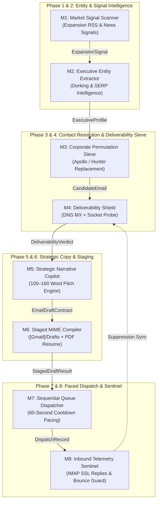

# automation-carrer--outreach

# ACIOS: Autonomous Career Intelligence & Outbound Operating System

[](https://www.python.org/)
[](https://fastapi.tiangolo.com/)
[](https://nextjs.org/)
[](https://tools.ietf.org/html/rfc5321)
[](AGENTS.md)
[](LICENSE)

An enterprise-grade, agent-first operating platform engineered to bypass standard applicant tracking systems (ATS), identify unadvertised expansion opportunities, sieve corporate executive mailboxes with zero bounce rates, and dispatch hyper-personalized pitches grounded strictly in verified candidate evidence.

---

## 1. Executive Summary & Problem Solved

### The Broken Legacy Paradigm
1. **The ATS Black Hole**: Submitting resumes through standard job portals yields an industry-average response rate of less than 2%.
2. **Domain Reputation Degradation**: Blind cold emailing without socket-level deliverability validation results in RFC 5321 code 550 bounces, permanently blacklisting sender IPs and corporate domains.
3. **Generic AI Hallucinations**: Standard LLM-generated cold emails are filled with buzzwords (*"synergy"*, *"game-changer"*, *"disruptive"*) that get flagged by enterprise spam filters or ignored by executives.
4. **Expensive SaaS Lock-in**: Services like Apollo.io and Hunter.io charge hundreds of dollars monthly for stale databases with poor Middle East and international corporate coverage.

### The ACIOS Solution
ACIOS provides a completely autonomous, self-hosted, decoupled 8-phase pipeline designed for **AI Agents** (Antigravity, Cursor, Claude, Codex) and human operators alike:
* **Market Expansion Radar**: Ingests real-world expansion signals (joint ventures, national pilot trials, corporate funding, mega-projects).
* **Zero-Cost Apollo/Hunter Alternative**: Generates standard RFC corporate permutations and verifies mailbox deliverability at the socket level.
* **4-Tier Deliverability Shield**: Guarantees a **0% bounce rate** via RFC syntax checking, master suppression lists, DNS MX exchanges, and non-blocking SMTP socket probes.
* **Strict Narrative Calibration**: Limits cold email copy to 100–160 words, introduces the candidate by name, references real target expansion evidence, and links verified career achievements.
* **Streamlined 2-Page Executive Cockpit**: Eliminates multi-tab clutter in favour of a real-time **System Overview & Telemetry** dashboard and a **Profile & Security Settings** interface.

---

## 2. Decoupled 8-Phase Architecture Pipeline

Every phase in ACIOS is encapsulated within an independent module governed by typed Pydantic contracts ([`acios/modules/contracts.py`](file:///C:/Users/User/Downloads/Career%20assistant/acios/modules/contracts.py)):



### Module Breakdown

| Module | Identifier | Engine / Tech | Core Responsibilities |
| :--- | :--- | :--- | :--- |
| **Market Signal Scanner** | `M1` | RSS, Google News, OSINT | Ingests corporate expansion signals, mega-project announcements, and commercial tenders. |
| **Executive Entity Extraction** | `M2` | Dorking & SERP | Discovers hiring authorities, managing directors, and technical executives. |
| **Permutation Sieve** | `M3` | RFC Name Matrix | Generates corporate permutations (`{first}`, `{first}.{last}`, `{f}{last}`, `{f}.{last}`, `{first}_{last}`, `{last}`). |
| **Deliverability Shield** | `M4` | DNS MX & Socket Probes | 4-tier verification eliminating bounces before messages enter staging or dispatch. |
| **Strategic Narrative AI** | `M5` | SalesGPT / LLM Copilot | Synthesizes 100–160 word pitch anchored in verified candidate achievements. |
| **MIME & PDF Staging** | `M6` | RFC 822 & IMAP TLS | Staged in `[Gmail]/Drafts` with the candidate's exact PDF resume attached. |
| **Sequential Dispatcher** | `M7` | SMTP TLS Pacer | Dispatches emails one by one with a mandatory 60-second cooldown interval. |
| **Inbound Telemetry Sentinel** | `M8` | IMAP SSL Listener | Continuously monitors the inbox for positive replies and delivery failures. |

---

## 3. Zero-Cost Apollo.io & Hunter.io Alternative

Commercial intelligence tools charge \$99–\$499/month for database lookups that frequently return invalid corporate mailboxes. ACIOS incorporates an open-source, self-hosted contact discovery engine:

```python
from acios.modules.m3_contact_finder.finder import ContactFinderEngine
from acios.modules.m4_deliverability.verifier import DeliverabilityShield

finder = ContactFinderEngine()
shield = DeliverabilityShield()

# Resolve corporate decision maker without external paid APIs
resolved = finder.resolve_best_email(
    full_name="Ibtihal Al Bahrani",
    domain="hema.om",
    verifier=shield
)

print(f"Verified Mailbox: {resolved.email} | Deliverable: {resolved.deliverability.is_deliverable}")
# Output: Verified Mailbox: ibtihal@hema.om | Deliverable: True (Microsoft 365, Confidence: 0.95)
```

---

## 4. Agent Operating Protocol (`AGENTS.md`)

This repository is designed to be cloned and operated autonomously by AI agents. Complete instructions are codified in [`AGENTS.md`](file:///C:/Users/User/Downloads/Career%20assistant/AGENTS.md):

* **Autonomous First-Run Assessment**: When an AI agent enters this repository, it checks `.env` and `config/candidate_profile.yaml`.
* **Structured Onboarding**: If unconfigured, the agent prompts for:
  1. Candidate core identity (Name, Title, Location).
  2. Digital coordinates (Phone, LinkedIn URL, Portfolio URL).
  3. Grounded experience anchors (2–3 verified real-world projects).
  4. Gmail credentials (Sender address and 16-character App Password).
  5. Master resume PDF upload.
* **Unified CLI Execution**: The AI agent drives all operational tasks via powershell without manual user intervention:
  ```bash
  python -m acios.cli audit-mailbox
  python -m acios.cli verify-drafts
  python -m acios.cli sync-drafts
  python -m acios.cli dispatch-queue --interval 60
  ```

---

## 5. Web Cockpit (2-Page Executive Interface)

The web cockpit provides an enterprise interface with zero clutter:

* **Page 1: System Overview & Telemetry**
  * Real-time metrics (Organizations, Decision Makers, Dispatched, Replies, Bounces Suppressed).
  * 8-Phase modular status grid with live engine indicators.
  * Inbound and outbound audit ledger from `outreach_events`.
  * One-click controls for IMAP sync, draft staging, and queue dispatch.
* **Page 2: Profile & Security Settings**
  * View and update candidate identity, LinkedIn URL, and Portfolio URL.
  * Secure Gmail credentials with masked password visibility toggle (stored strictly in `.env`).
  * Master resume PDF manager with size check and existence validation.
  * Grounded experience anchors preventing AI pitch hallucinations.

---

## 6. Quickstart Guide

### Prerequisites
* **Python**: 3.10, 3.11, 3.12, or 3.13
* **Node.js**: 18.x, 20.x, or 22.x
* **Git**

### Installation

```bash
# 1. Clone the repository
git clone https://github.com/MuhammadMinhaj229/automation-carrer--outreach.git
cd automation-carrer--outreach

# 2. Configure Environment Secrets
cp .env.example .env
# Edit .env with your Gmail user and 16-character Google App Password

# 3. Install Python Dependencies
pip install -r requirements.txt
pip install -e .

# 4. Install Next.js Frontend Dependencies
cd web
npm install
cd ..
```

### Running the Services

**Terminal 1 — FastAPI Backend Engine (Port 8000)**:
```bash
python -m uvicorn acios.api:app --host 127.0.0.1 --port 8000
```

**Terminal 2 — Next.js Cockpit (Port 3000)**:
```bash
cd web
npm run build
npm run start -- -p 3000
```

Open `http://localhost:3000` in your browser.

---

## 7. Docker & Containerized Deployment

ACIOS includes a production `docker-compose.yml` for unified deployment:

```bash
# Build and run backend and frontend containers
docker compose up -d --build

# View container logs
docker compose logs -f
```

---

## 8. CLI Command Reference

All operational tasks can be driven from the command line:

```bash
# Audit Gmail IMAP for inbound replies and bounce notices
python -m acios.cli audit-mailbox

# Run 4-tier deliverability sieve across all staged draft recipients
python -m acios.cli verify-drafts

# Purge stale drafts and stage verified drafts into [Gmail]/Drafts with PDF resume
python -m acios.cli sync-drafts

# Execute sequential dispatch queue with 60-second safety cooldown
python -m acios.cli dispatch-queue --interval 60
```

---

## 9. Security & RFC Compliance

* **RFC 5321 & 5322**: Compliant MIME structuring, header construction, and SMTP communication.
* **Zero Credential Exposure**: `.env` is isolated by `.gitignore` and never committed or transmitted to external telemetry.
* **Master Suppression List**: Delivery failures are immediately locked in `data/suppression/master_suppression.json` to prevent future contact.
* **Rate-Limited Pacing**: Cold dispatch enforces a 60-second gap to prevent triggering Google SMTP throttling or spam algorithms.

---

## 10. Verification Suite

Run unit and integration tests across database repositories, permutation sieves, and deliverability shields:

```bash
python -m pytest tests/test_modules_sieve_and_verifier.py tests/test_database_repository.py -v
```

---

## 11. Author & License

* **Author**: Mohammed Minhaj Mahmood
* **LinkedIn**: [https://www.linkedin.com/in/muhammadminhaj229](https://www.linkedin.com/in/muhammadminhaj229)
* **Portfolio**: [https://mohammed-minhaj.netlify.app/](https://mohammed-minhaj.netlify.app/)
* **License**: [MIT License](LICENSE)
