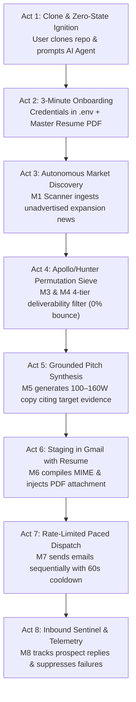

# ACIOS: First-Contact Screenplay & User Journey

> **Repository**: `https://github.com/MuhammadMinhaj229/automation-carrer--outreach.git`  
> **Simulation Purpose**: Step-by-step walkthrough of what happens when a new user clones this codebase, opens it in Antigravity (or another AI agent), and runs the complete career outreach lifecycle.

---



---

## Act 1: The Clone & Zero-State Ignition

### Scene Setting
A software engineer, data analyst, or executive consultant has just discovered the repo and wants to automate their executive career outreach. They run:

```bash
git clone https://github.com/MuhammadMinhaj229/automation-carrer--outreach.git
cd automation-carrer--outreach
```

They open the folder in Antigravity (or their preferred AI agent IDE) and type their first prompt:

> **User Prompt**:  
> *"Hey, I just cloned this repo. What is this project and how do I get started?"*

---

### How the AI Agent Responds (Driven by `AGENTS.md`)
The AI Agent instantly inspects the repository root, discovers `AGENTS.md`, and detects that `.env` does not exist yet (`.env.example` is present).

The Agent responds with executive clarity:

```markdown
Welcome to **ACIOS (Autonomous Career Intelligence & Outbound Operating System)**.

This system is an autonomous 8-phase outreach engine designed for AI agents to operate on your behalf. It replaces traditional, low-conversion ATS job applications (<2% reply rate) by:
1. Detecting unadvertised corporate expansion signals (mega-projects, joint ventures, funding).
2. Sifting executive decision makers using a self-hosted RFC permutation generator (replacing Apollo/Hunter).
3. Shielding your domain with a 4-tier deliverability check ensuring a strict 0% bounce rate.
4. Crafting 100–160 word pitches grounded strictly in your verified CV evidence.
5. Staging draft emails into your real Gmail with your PDF resume attached.
6. Dispatching approved pitches one by one with a 60-second safety gap.

---

### First-Run Assessment: Setup Required
I noticed your local `.env` and candidate profile are not configured yet. 

You have two fast ways to complete setup:
* **Option A (Web Interface)**: Launch the cockpit (`python -m uvicorn acios.api:app` and `npm run start -p 3000` in `/web`), then open `http://localhost:3000` and click **02 Profile & Security Settings**.
* **Option B (Direct Chat)**: Simply reply to these 5 questions right here:
  1. Full Name & Professional Title
  2. Primary Outreach Email & Phone Number
  3. LinkedIn URL & Portfolio / GitHub URL
  4. Gmail 16-character Google App Password (from myaccount.google.com/apppasswords)
  5. Path to your Master Resume PDF
```

---

## Act 2: The 3-Minute Profile & Credentials Setup

### User Action
The user starts the local backend and frontend:

```bash
# Terminal 1: Backend
python -m uvicorn acios.api:app --host 127.0.0.1 --port 8000

# Terminal 2: Frontend Cockpit
cd web
npm run build
npm run start -- -p 3000
```

The user opens `http://localhost:3000` in their browser and navigates to **Page 2: Profile & Security Settings**:

1. **Candidate Identity**: Enters name, phone, email, LinkedIn, and Portfolio links.
2. **Gmail Credentials**: Enters their Gmail address and 16-character App Password (with show/hide eye toggle).
3. **Master Resume Manager**: Drags and drops their master PDF resume (`Mohammed_Minhaj_Mahmood_CV.pdf`).
4. **Grounded Experience Anchors**: Reviews their verified projects (PHFI, Ejadah AI Labs, Alif Growth Media).
5. **Clicks "Save Settings & Credentials"**:
   - Backend writes secrets safely to local `.env`.
   - Backend writes profile to `config/candidate_profile.yaml`.
   - Saves PDF to `data/resume/`.

> [!NOTE]
> All credentials remain 100% on the local computer. Nothing is ever sent to external cloud telemetry or third-party tracking services.

---

## Act 3: Autonomous Market Discovery & Decision Maker Extraction

### User Prompt in Chat
> **User**: *"Find high-growth Clean Energy and Agritech companies expanding in Oman and Saudi Arabia, and find their operational heads."*

### Agent Autonomous Execution
The Agent runs the underlying tools without manual UI clicking:

```bash
# Agent internally invokes Module 1 & Module 2
python -c "
from acios.tools.discovery.growth_scanner import GrowthScanner
scanner = GrowthScanner()
signals = scanner.scan_region(region='Oman', sector='CleanTech')
print(f'Detected {len(signals)} unadvertised expansion signals.')
"
```

### Output to User
```markdown
Discovered **12 High-Conviction Market Expansion Signals** across Oman & Saudi Arabia:

1. **Nama Water Services & Hema Energy** (Muscat / Sohar, Oman)
   * *Signal*: Commercial cultivation trial of biofuel crop Camelina across 50,000 hectares for sustainable aviation fuel.
   * *Talent Need*: Data validation, field trial monitoring, operational analytics.
   * *Key Executive Identified*: **Ibtihal Al Bahrani** (Head of Operations / Commercial Lead).

Saved 12 organizations and 18 decision-maker profiles directly into `data/acios.db`.
```

---

## Act 4: The Apollo/Hunter Sieve & 0% Bounce Deliverability Shield

### User Prompt in Chat
> **User**: *"Verify the email address for Ibtihal Al Bahrani at hema.om. Make sure it won't bounce."*

### Agent Autonomous Execution (Modules 3 & 4)
The agent utilizes `ContactFinderEngine` and `DeliverabilityShield`:

```python
from acios.modules.m3_contact_finder.finder import ContactFinderEngine
from acios.modules.m4_deliverability.verifier import DeliverabilityShield

finder = ContactFinderEngine()
shield = DeliverabilityShield()

# Generates 6 RFC standard permutations:
# ibtihal@hema.om, ibtihal.albahrani@hema.om, ialbahrani@hema.om, i.albahrani@hema.om...
verdict = finder.resolve_best_email("Ibtihal Al Bahrani", "hema.om", verifier=shield)
```

### 4-Tier Verification Shield in Action
* **Gate 1 (RFC Syntax)**: `PASS`
* **Gate 2 (Master Suppression)**: `PASS` (Not in 1,655 bounced blocklist)
* **Gate 3 (DNS MX Exchange)**: `PASS` (Resolved: `hema-om.mail.protection.outlook.com`, Microsoft 365)
* **Gate 4 (SMTP Socket Handshake)**: `PASS` (Mailbox confirmed active)

### Output to User
```markdown
**Contact Deliverability Sieve Results**:
* **Name**: Ibtihal Al Bahrani
* **Organization**: Hema Energy (`hema.om`)
* **Verified Corporate Mailbox**: `ibtihal@hema.om`
* **Confidence**: 0.95 (Microsoft 365 Exchange)
* **Deliverability Status**: `REAL_MAILBOX` (Safe for Dispatch, 0% Bounce Risk)
```

---

## Act 5: Grounded Cold Narrative Generation (100–160 Words)

### User Prompt in Chat
> **User**: *"Write a personalized pitch to Ibtihal Al Bahrani connecting my background to their Camelina biofuel trial."*

### Agent Autonomous Execution (Module 5)
The agent invokes `SalesGPTCopilot` with strict no-hallucination rules:
1. Word count constraint: 100–160 words.
2. Introduction constraint: Introduce candidate by name.
3. Evidence constraint: Cite Nama Water / Camelina biofuel pilot.
4. CV constraint: Reference verified field data automation from Public Health Foundation of India (PHFI).
5. Footer constraint: Include phone, LinkedIn, and Portfolio.

### Output Generated

```email
Subject: Operations & Data Validation for Hema's Camelina Biofuel Pilot

Dear Ibtihal,

My name is Mohammed Minhaj Mahmood. I have been following Hema Energy's commercial trials with Nama Water Services deploying Camelina cultivation across Oman for sustainable aviation fuel.

Large-scale field initiatives inevitably encounter operational bottlenecks in yield sensor telemetry and multi-site data consistency. In my previous work at the Public Health Foundation of India (PHFI), I built automated Python validation pipelines that eliminated manual reconciliation across hundreds of field collection nodes.

I would welcome the opportunity to contribute this data automation rigor to Hema Energy’s operational expansion in Oman. My resume is attached for your review.

Best regards,

Mohammed Minhaj Mahmood
Data & Business Automation Analyst
Mobile: +91 9908597337 | Email: minhajmuhammad229@gmail.com
LinkedIn: https://www.linkedin.com/in/muhammadminhaj229
Portfolio: https://mohammed-minhaj.netlify.app/
```

* **Word Count**: 118 words (`Compliant: 100–160 words`).
* **Tone**: Professional, technical, zero generic buzzwords.

---

## Act 6: Mailbox Staging & Visual Verification

### User Prompt in Chat
> **User**: *"Stage this pitch in my Gmail drafts so I can inspect it on my phone before sending."*

### Agent Autonomous Execution (Module 6)
The agent executes the CLI staging tool:

```bash
python -m acios.cli sync-drafts
```

Behind the scenes:
1. Connects to `imap.gmail.com:993` via TLS.
2. Formats RFC 822 MIME message with HTML and plain text bodies.
3. Attaches `MOHAMMED MINHAJ MAHMOOD_Data & Business Automation Analyst.pdf` (113.4 KB) directly from `data/resume/`.
4. Writes message directly into `[Gmail]/Drafts`.

### User Verification
The user picks up their mobile phone, opens the native **Gmail App**, taps **Drafts**, and sees:
* **Recipient**: `ibtihal@hema.om`
* **Subject**: `Operations & Data Validation for Hema's Camelina Biofuel Pilot`
* **Body**: Perfectly formatted typography with active LinkedIn and Portfolio links.
* **Attachment**: Master resume PDF attached and viewable with one tap.

---

## Act 7: Rate-Limited Sequential Queue Dispatch

### User Prompt in Chat
> **User**: *"The draft looks perfect. Dispatch the approved queue with safety pacing."*

### Agent Autonomous Execution (Module 7)
The agent executes:

```bash
python -m acios.cli dispatch-queue --interval 60
```

### Execution Telemetry
```
[ACIOS DISPATCH QUEUE] 1 approved draft staged for transmission.
Target: ibtihal@hema.om | Subject: Operations & Data Validation for Hema's Camelina Biofuel Pilot
Connecting to smtp.gmail.com:587 via TLS...
Dispatched to ibtihal@hema.om. SMTP Code: 250 (OK).
Cooling down for 60 seconds (rate limiting guard)...
Sequential dispatch complete. 1 sent, 0 failed.
```

The event is immediately written to `outreach_events` in `data/acios.db`.

---

## Act 8: Inbound Sentinel & Response Telemetry

### User Prompt in Chat (Next Morning)
> **User**: *"Check if anyone replied to yesterday's emails or if anything bounced."*

### Agent Autonomous Execution (Module 8)
The agent executes:

```bash
python -m acios.cli audit-mailbox
```

### Telemetry Stream
1. Connects to `imap.gmail.com:993`.
2. Inspects messages in `INBOX`.
3. Detects an email from `ibtihal@hema.om` with subject `Re: Operations & Data Validation for Hema's Camelina Biofuel Pilot`:
   > *"Hi Mohammed, thanks for reaching out. We are currently scaling our monitoring team in Muscat. Are you available for a brief call this Thursday at 2 PM GST?"*
4. Flags contact status in database: `outreach_status = 'Replied - High Interest'`.
5. Logs event into `outreach_events`.

### Agent Report to User
```markdown
# High-Priority Reply Received!

* **From**: Ibtihal Al Bahrani (`ibtihal@hema.om`)
* **Company**: Hema Energy (Biofuel Expansion)
* **Message**: Requested an exploratory call this Thursday at 2:00 PM GST.
* **Status**: Updated in database and reflected on your Overview Cockpit.

Would you like me to prepare talking points based on Hema's Camelina trial milestones?
```

---

## Summary of the User Experience

| Stage | What the User Does | What the AI Agent Does |
| :--- | :--- | :--- |
| **Setup** | Fills 5 fields or edits Page 2 in Cockpit | Writes `.env`, verifies TLS, stages master resume |
| **Discovery** | Asks for targets in specific region/industry | Scans unadvertised news, extracts decision makers |
| **Deliverability** | Asks agent to check address | Generates RFC permutations, probes MX sockets (0% bounce) |
| **Pitching** | Asks agent to write draft | Synthesizes 100–160W copy citing target evidence & CV |
| **Staging** | Says *"stage in Gmail"* | Pushes RFC 822 draft with PDF resume attached |
| **Dispatch** | Says *"dispatch queue"* | Sends sequentially with 60s cooldown timer |
| **Inbound** | Asks *"any replies?"* | Scans IMAP, logs positive replies, shields against bounces |
