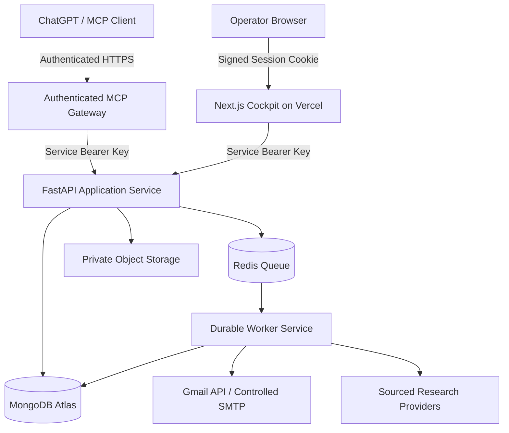

# ACIOS Production Architecture

## 1. Recommended Production Topology

## 2. Component Responsibilities

| Component | Recommendation | Purpose |
| :--- | :--- | :--- |
| **Frontend** | Vercel + Next.js | Web cockpit, signed operator sessions, BFF proxy |
| **API** | FastAPI on a persistent container service | Business logic, input validation, research pipeline, draft approval |
| **Database** | MongoDB Atlas (`MONGODB_URI`) | Organizations, signals, contacts, drafts, approvals, idempotency locks, and job records |
| **Background Jobs** | Redis (`REDIS_URL`) + `acios.worker` | Long-running scans, retries, and asynchronous task execution |
| **File Storage** | Private object storage / validated local store | Resumes and generated reports |
| **Email** | Controlled SMTP / Gmail integration | Draft staging and idempotent sending of explicitly approved drafts |
| **AI Connection** | Authenticated MCP gateway (`/api/mcp`) | Narrow, explicitly authorized ChatGPT / MCP tools |
| **Monitoring** | Structured logs and outreach event ledger | Access logs, errors, and immutable job/dispatch history |

## 3. Narrow Authorized MCP Tools

The MCP gateway (`/api/mcp`) and OpenAPI specification (`/api/openapi.json`) expose 8 narrow, explicitly authorized tools:

1. `search_growth_signals` — discover companies and their expansion evidence.
2. `get_company_dossier` — retrieve sourced company and decision-maker information.
3. `verify_contact` — return verification evidence and confidence score, never an unsupported guarantee.
4. `create_outreach_draft` — create a draft in `PENDING_APPROVAL` status without sending it.
5. `list_pending_approvals` — retrieve drafts awaiting approval.
6. `approve_outreach` — approve a specific draft after authenticated confirmation.
7. `send_approved_outreach` — send only a previously approved draft, enforcing atomic duplicate-send protection (`dispatch_locks`).
8. `get_job_status` — check status and retries of long-running background jobs.
