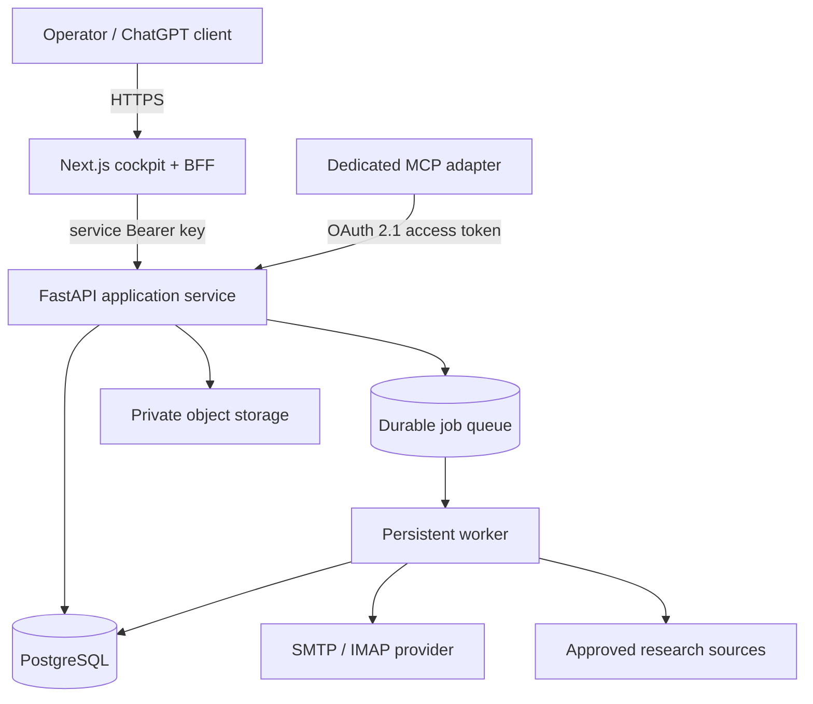

# ACIOS production architecture

## Deployment topology

## Service responsibilities

- **Vercel / Next.js:** UI, signed operator session, same-origin API proxy, and OpenAPI schema. Never put backend service credentials in a browser bundle.
- **FastAPI:** authentication, input validation, domain logic, audit trail, and status transitions. It must reject every application request when the service key is absent or invalid.
- **Worker:** long-running discovery and mailbox jobs, retries, and paced dispatch. Do not launch daemon threads from request handlers on serverless infrastructure.
- **PostgreSQL:** durable system of record for companies, signals, contacts, drafts, approvals, suppression records, and dispatch events.
- **Queue:** durable task delivery, retry/backoff, deduplication/idempotency keys, and concurrency limits.
- **Object storage:** private resumes and generated reports; use short-lived signed URLs instead of public repository files.
- **MCP gateway:** dedicated protocol adapter with OAuth 2.1 authorization and narrow tool scopes. Prefer read/search tools first; email sending requires explicit approval and a final authorization check.

## Database choice

MongoDB can persist these documents, but it does not run the FastAPI API, worker, queue, or scheduler. PostgreSQL is the recommended production store for ACIOS because the data is relational and dispatch history requires unique constraints and transactional state transitions. SQLite currently exists in the repository for local development; a PostgreSQL repository/migration is still a go-live prerequisite. Setting DATABASE_URL alone does not move the existing SQLite database to PostgreSQL.

## Scaling model

Start as two application services plus one worker and a managed database/queue. Scale the web tier independently; scale API replicas statelessly; scale workers horizontally only after jobs are idempotent and queue/DB concurrency is tested. Keep production separate from preview environments. Add metrics for queue age, error rate, provider latency, retries, suppression blocks, and dispatch outcomes.

## Go-live gates

1. Scrub sensitive repository history and rotate exposed credentials.
2. Configure real secrets and backend URL through provider secret managers.
3. Migrate SQLite to PostgreSQL and verify schema/data migration.
4. Add a durable queue/worker and remove request-thread background jobs.
5. Configure OAuth 2.1 for ChatGPT custom MCP; a static bearer token is not a substitute for this OAuth flow.
6. Test authentication, ownership, rate limits, uploads, idempotency, suppression enforcement, and non-production isolation.
7. Run end-to-end smoke tests from Vercel through FastAPI, queue, worker, database, and mailbox using non-production recipients.