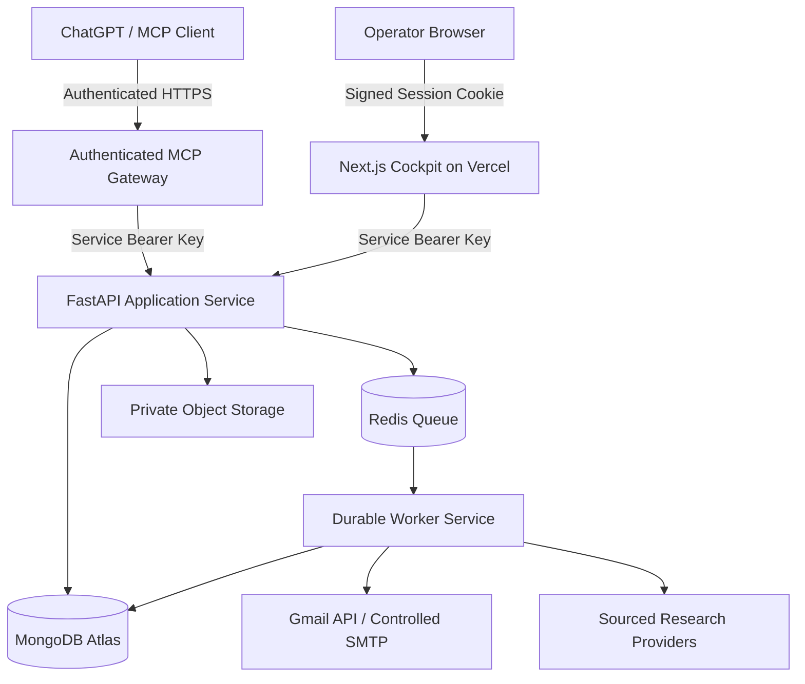

# ACIOS Production Architecture

## 1. Recommended Production Topology

## 2. Component Responsibilities

| Component | Recommendation | Purpose |
| :--- | :--- | :--- |
| **Frontend** | Vercel + Next.js | Web cockpit, signed operator sessions, BFF proxy |
| **API** | FastAPI on a persistent container service | Business logic, input validation, research pipeline, draft approval |
| **Database** | MongoDB Atlas (`MONGODB_URI`) | Organizations, signals, contacts, drafts, approvals, idempotency locks, and job records |
| **Background Jobs** | Redis (`REDIS_URL`) + `acios.worker` | Long-running scans, retries, and asynchronous task execution |
| **File Storage** | Private object storage / validated local store | Resumes and generated reports |
| **Email** | Controlled SMTP / Gmail integration | Draft staging and idempotent sending of explicitly approved drafts |
| **AI Connection** | Authenticated MCP gateway (`/api/mcp`) | Narrow, explicitly authorized ChatGPT / MCP tools |
| **Monitoring** | Structured logs and outreach event ledger | Access logs, errors, and immutable job/dispatch history |

## 3. Narrow Authorized ChatGPT / MCP Tool Surface

The OpenAPI Actions gateway and remote MCP adapter do **not** provide a machine-callable approval operation. Available operational tools are:

1. `search_growth_signals` — search sourced expansion signals and optionally enqueue a research scan.
2. `get_company_dossier` — retrieve saved company, signal, and decision-maker records.
3. `verify_contact` — return evidence-backed syntax/MX/banner observations without guaranteeing mailbox existence.
4. `create_outreach_draft` — create a `PENDING_APPROVAL` draft without sending.
5. `list_pending_approvals` — list drafts awaiting human review.
6. `send_approved_outreach` — enqueue a draft only if its stored status is already `APPROVED`; it does not send inside the HTTP request.
7. `get_job_status` — check the state and result of asynchronous work.

The MCP gateway additionally exposes read-only overview and statistics tools. The signed-in web cockpit is the only approval surface. It records the human operator and approval timestamp; a ChatGPT/OpenAPI/MCP bearer token cannot approve a message on the operator's behalf. Dispatch is handled by the worker with idempotency protections and manual reconciliation for ambiguous SMTP outcomes.

OpenAPI Actions and MCP have separate credentials. The OpenAPI token is restricted at the Next.js proxy to the versioned, documented action paths; it must not be treated as a backend service token. The remote MCP route uses a static bearer token, not an OAuth authorization server. If a ChatGPT connection requires OAuth 2.1, that provider flow must be implemented and configured before connecting it.

## 4. Production Readiness Gates

- Configure Vercel with the deployed FastAPI HTTPS URL and the same backend service key configured on FastAPI.
- Configure MongoDB Atlas, and set `ACIOS_ENV=production` plus `MONGODB_URI` on both the API and worker. Production fails closed instead of silently creating a local SQLite database when a managed-host marker is present.
- Deploy `python -m acios.worker` as a persistent worker process.
- Configure private shared resume storage (S3-compatible storage for separately hosted API/worker processes).
- Keep `DRY_RUN=true` until the worker, resume, queue, and database checks pass.
- Require authenticated human approval for each message, respect suppression lists, and reconcile uncertain SMTP results before any manual retry.
- Make the repository private during history cleanup, rotate any credentials that were committed, then rewrite Git history and coordinate clone/fork cleanup.

